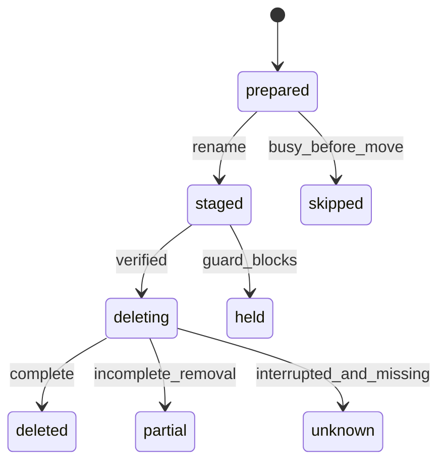

# 存储生命周期规则与验证

更新日期：2026-11-12 UTC。envY 提供共享默认规则，机器按稳定 ID 增加、排除和局部覆盖。最新变更补齐微信和 Zotero 的更新缓存规则，收紧飞书和 VS Code 的暂存选择范围，并补充后台更新器拦截。下文保留 2026-11-11 的 NAS 合成归档验证与只读报告，历史统计按各自记录时间解释。

## 当前源码：立即回收入口

`envy storage prune` 扫描当前符合条件的内容，显示范围后只确认一次，随后立即清理。无需手动创建 plan、选择 run 或复制 token：

```bash
envy storage prune
envy storage prune --dry-run
envy storage prune --yes
envy storage prune -f
envy storage prune --force
envy storage prune --yes --json
```

`--yes`、`-f`、`--force` 是同一确认参数，跳过提示，仍保留年龄、路径、来源及占用检查。`--dry-run` 不清理，与确认参数互斥；JSON 和非交互执行必须显式确认。扫描会保存内部计划并锁定 storage state，不改动候选内容；执行结果使用现有 JSON envelope。

每条规则的 `prune` 布尔字段默认 `false`。当前只给 `vscode-gpu-cache`、`codex-shader-cache`、`chrome-shader-cache`、`feishu-shader-cache`、`feishu-iron-shader-cache`、`steam-shader-cache` 六条精确 GPU/Shader 缓存规则标记 `prune = true`，它们的普通 `action` 仍为 `quarantine`。机器可通过同 ID 的 `prune = false` 撤销资格。未标记的隔离规则，包括更新包、日志和下载内容，不会被 prune 直接删除；旧 `run` 和 `purge` 继续原有保留期。

显式 `archive` 规则在 NAS 上传后回读一次 SHA-256，执行前确认本地对象未变化，成功后同次释放本地副本；失败保留本地。归档仍限普通文件，不自动删除远端快照。专用 `prunes` 记录保存 repository ID、snapshot、文件 SHA-256 和逐项结果；这些记录目前不接入旧 `restore RUN`，远端恢复使用其中的快照信息。

原生维护复用机器已启用的 Nix、Docker、Go、uv、npm、pip、Homebrew 动作及其目标绑定和保留边界。文件候选数与原生维护数分别显示；某个动作失败或不可用后继续其他动作，同一动作内部失败则停止剩余步骤，最终有失败时返回非零。执行时按动作实时显示脱敏后的 stdout/stderr，过程文本统一写 stderr，JSON stdout 只保留结果。末尾按工具报告汇总删除数量、回收空间和具体错误；未报告的数字不补零。没有错误详情时提供绑定目标的只读诊断命令。每一步的 stdout/stderr 脱敏日志保存在 storage state 的 `prune-output/<id>/`，终端给出日志目录，可用 `less <日志路径>` 查看。每路只保留末尾最多 1 MiB，截断时注明；目录权限为 0700，日志为 0600。输出按完整行显示，超过 16 KiB 的单行以省略标记替代。`--force` 是 envY 确认别名，不传给 uv 或扩大原生范围。

Darwin Nix 通过共享 `esudo` 使用 sops 密码或已有 sudo 票据，先认证、重新核对绑定，再执行清理。stderr 在 `ENVY_DEBUG=0` 时也显示密码来源、`password is given (******末字符)` 掩码及认证成功状态；提供密码与认证成功分别报告。认证失败不会重试清理命令，也不会阻止 uv、npm 等后续动作。JSON stdout 只包含结果。

占用、变化及消失的候选会跳过，全跳过且无其他失败返回成功；权限、工具或归档失败返回非零。若暂存后发现占用或删除中断，保留路径和状态会写入 `prunes`，不会自动加入旧 purge。终端分别报告删除、归档释放、跳过、暂存保留和原生动作状态；汇总中错误不重复列出，只有存在删除或工具报告时才显示大小。JSON 和记录另保留候选大小估计、原生报告回收量及可用空间变化；APFS 共享块及同时运行的其他进程会影响后者。完成删除的可丢弃缓存没有恢复副本。

## 2026-11-15 升级：操作预览与确认

本节记录完整升级阶段 6 的源码实现；后文的真实隔离、NAS 与空间统计仍属于各自标注日期的历史证据。本次操作测试与故障注入使用合成临时文件和 fake providers；标准 Git 检查通过 Python 1347 项（47 跳过）、Storage 331 项（无跳过）、Rust 184 项（无跳过）、Codex 27 项（1 跳过）及 lint、agent、平台边界，独立复核确认已报告问题闭环。另有 Nix 2.33.1 本地 store 的只读元信息探针，仅验证 URI 与 feature 兼容性；未执行新的宿主清理、恢复、NAS 写入、apply 或调度启用。

`storage capabilities --json` 提供动作、政策 opt-in、flags、副作用及 CLI/TUI 覆盖，不扫描或读取归档口令。TUI 逐命令覆盖与按键见 [TUI 前端边界](tui.md#storage-预览与确认)。首次 Storage 仍只 inspect；操作页只读取 capabilities，保存 plan 必须显式触发。

`run PLAN`、显式非空选择的 `maintain`、`purge` 和 `restore RUN --target ABS` 支持两步协议：先用 `--preview --json` 获取预览，再用同一请求及 `--preview-token TOKEN --yes --json` 确认；两步 flags 不能混用。旧 CLI 默认语义保留，尤其旧 restore 仍直接写入，TUI 必须使用新协议。新 run 拒绝无 producer 来源证明的旧 plan，须主动重新生成，不能给任意 JSON 追加 hash 就成为可信计划。

私有 token 绑定政策、源码、同一机器及宿主、state 文件系统身份、完整请求和计划/恢复/清退证据，默认有效期 300 秒。维护另绑定 executable、cwd、配置元数据与实际 cache/prefix/store：Docker 固定 context/endpoint/daemon/builder，Go 固定 cwd 与缓存，Go module cache 仍独立 opt-in。预览到确认及每步原生执行前复验；漂移、过期或无法证明目标时拒绝。原生 Nix 仅支持可证明的固定本地 store，确认 GC 保留 generations；`gc` 删除旧 generation 的行为仍独立。

确认持有既有 state lock，严格同步单次 claim 的文件与目录并重读，再调用原有引擎。重复 token 只返回原结果或中断后的 unknown，不盲目重放；已消费结果读取仍检查请求与宿主归属。结果持久化或状态刷新失败会保留已知成功、逐项错误和 unknown，不伪称回滚。取消后无法证明的外部效果保持 unknown。

purge 固定到预览批准的 `(run,path)` 和内容证据；新 run 或同 run 后来到期的条目不扩入。恢复预览不创建目标；远端证据校验可能读取归档并需要凭据。确认后只写新的绝对目标，held 与已有单文件 archive 复用同一恢复选择；远端通过现有 restic dump 流写入独占创建的 FD 并校验 SHA-256，不把最终目标路径交给 restic。输出名称及父目录复验不能视作应用参与的原子锁，失败可留下本次新建的部分目标；未知远端格式或目录归档仍不支持。

init/check/gc 首版仅为可发现的 CLI 交接，展示完整 argv、目标、参数、退出方式与副作用，打开说明不会执行。`storage check` 内部固定 restic `check --read-data`，envY CLI 不接受额外 `--read-data`；gc 无 JSON，不能与 `maintain --nix` 混同。`run --scheduled` 仍只属后台政策，report 是模式。

## 共享规则与机器选择

规则由 `modules/storage/rules/common.nix`、`darwin.nix`、`linux.nix` 提供，`default.nix` 组合当前平台贡献。路径从 `config.envy.user.home` 推导，机器无需导入 `hosts/default.nix` 才能获得默认规则。

`envy.storage.rules.include.<id>` 是合并后的定义，`exclude` 优先，`effective` 是只读最终列表。Nix 负责合并，Python 只消费有效结果。共享字段使用 `mkDefault`，同优先级的冲突定义报错，机器只需指定发生差异的字段：

```nix
# Keep the shared rule but change one field.
envy.storage.rules.include.old-installers.minAgeDays = 60;

# Remove a shared rule, including its rule-owned protection grants.
envy.storage.rules.exclude = [ "chrome-code-cache" ];

# Add a machine rule; missing custom roots fail unless explicitly optional.
envy.storage.rules.include.local-build-cache = {
  path = "${config.envy.user.home}/.cache/local-build";
  action = "quarantine";
  minAgeDays = 45;
};
```

规则携带 `id`、`source`（`default:common`、`default:darwin`、`default:linux` 或 `machine`）、`overriddenFields`、`optionalRoot` 与 `protectedOverrides`。status、validate 和 plan 保留来源、覆盖、排除、缺失与阻塞原因。共享规则显式设置 `optionalRoot = true`；机器自定义规则默认 false。目录不存在可以跳过，权限错误、非法路径与配置错误不能被当作“未安装应用”。

旧 Nix `rules = [ ... ];` 已迁移且会被类型检查拒绝。旧版本 manifest 的规则列表仍可读取；模型版本为 2，指纹含模型版本、规则元数据与最终政策，旧 plan 不可执行。config/setup 重写 managed block 时保留机器级 include、exclude、局部覆盖与自定义规则。

当前选择：Air 为 `manual`，29 条 Darwin 默认规则中因 native Go 选择排除 `go-build-cache`，得到 28 条有效规则；另一台 Darwin 保持 `manual`，获得 29 条默认规则；Linux 保持 `manual`，获得旧安装包与 Go 年龄规则两项。没有启用 auto 或定时器。`report` 阻止默认及定时执行；显式 `run --yes` 仍是写入操作。

首次真实 manual 试跑于 2026-11-13 00:30（本机时间）完成：`037b3b8950b14c1cade72b5dc82cf1c3` 隔离两个旧微信日志，共 3,717,360 B（约 3.55 MiB），并核对原始与隔离后的 SHA-256、inode 和保留期。89 项因声明的进程仍在运行而保留；飞书在执行前已启动，因此先前可处理的两处飞书缓存也未移动。当前 CLI 将这些保护拒绝记入 `errors` 并返回 `partial_failure` / exit 1；两个日志的实际状态为 `quarantined`。隔离保留到 2026-12-13 00:30（+08:00）之后，尚未执行 purge，也未因此释放磁盘空间。

## 更新下载包规则

更新下载和解包暂存通过共享规则进入 `plan → run → quarantine → purge` 生命周期。路径均从机器 home 推导；下表路径相对 `~/Library/`。

| 规则 ID | 选择范围 |
|---|---|
| `feishu-update` | `Application Support/LarkShell/update` 下的 `update.noindex`、`update_downloading` 两个目录；授权也仅限这两个子目录 |
| `codex-sparkle` | `Caches/com.openai.codex/org.sparkle-project.Sparkle/Installation` 的直接子目录 |
| `vscode-shipit` | `Caches/com.microsoft.VSCode.ShipIt/update.*` 下名为 `Visual Studio Code.app` 的目录 |
| `wechat-sparkle` | `Caches/com.tencent.xinWeChat/org.sparkle-project.Sparkle/Installation` 本层和直接会话目录内的 DMG；不进入解包应用 |
| `zotero-update-archive` | `Caches/Zotero/updates/Applications/Zotero/updates/0/update.mar` 普通文件 |
| `zotero-update-staging` | 同一 Zotero 更新根下的 `Updated.app` 目录 |

这六条规则均采用 14 天年龄门限、可缺失根和 quarantine。微信原始包采用 `depth = 2` 和 `extensions = [ "dmg" ]`；其余为 `depth = 1`，目录还要求所有后代均满足年龄。Zotero 路径对应 `/Applications/Zotero.app` 的实际缓存布局，其他布局可通过机器的同 ID `path` 覆盖。更新器程序、状态文件、Sparkle 的 `Launcher` 和已安装应用不在选择范围内。缺失缓存会在报告中显示跳过原因。

应用主进程和相关后台更新器都会阻止操作：完整命令行模式覆盖应用 bundle、Sparkle Launcher、ShipIt、飞书 darwin-updater 和 Zotero 更新路径。即使主应用已退出，后台更新器仍活跃也会被跳过；执行已保存计划前还会重新检查。storage 不退出、重开或升级应用。

解包应用若包含框架或资源符号链接，仍会被既有目录保护跳过；本次没有放宽符号链接和硬链接限制，目录占用不能直接算作可回收量。

这套规则按年龄和活动状态判断过期缓存，尚未实现“确认安装成功后立即删除”的版本或完成状态条件。近期下载即使无人占用，也不会因为目录较大而入选。默认 quarantine 保留 30 天，移动到隔离区不立即释放磁盘空间；到期 purge 才释放本地副本。`report` 只预览，启用自动执行需明确选择 `auto`。

专用 storage 检查把实际 Nix 目录导出为 fixture，在隔离 home 中用真实 organize 验证选择范围、近期后代、后台更新器阻塞、执行前复查、可缺失根和隔离恢复；fixture 不读取真实应用数据。

## 能力与安全边界

| 字段 | 语义 |
|---|---|
| `path` | home 下的绝对路径，可有内部 glob；envY 自行展开并保留权限错误 |
| `targets` / `depth` / `names` | 文件或目录、扫描深度、精确名称；depth=1 为直接子项 |
| `recursiveAge` | 目录及子树所有条目均需超过年龄门限 |
| `processes` | 必须退出的进程；带斜杠的模式匹配完整命令行 |
| `extensions` / `minAgeDays` / `minSizeBytes` | 文件后缀、年龄和大小条件 |
| `action` | quarantine 或 archive；目录仅支持 quarantine，archive 只支持普通文件 |
| `prune` | 默认 false；显式 prune 可立即删除该规则匹配的可丢弃缓存，普通 run 仍使用 action |
| `protectedOverrides` | 该有效规则所需的精确缓存/更新目录授权；排除规则会撤销其授权 |

不放开整个 Application Support、Containers 或用户 profile。state、checkout、SSH/GPG/sops 密钥、Keychain、Mail、Messages 及显式保护路径不可豁免；候选包含这些路径的祖先目录也受保护。内部通配符可以定位用户缓存，但授权末段必须是明确目录。符号链接、硬链接、不安全所有者、权限未知及活动文件检查失败均拒绝操作。

相同路径及父子候选重叠会报告涉及的规则并拒绝整个 plan；执行存储 plan 前再次检查。文件执行前复核签名与内容，归档后读回比较 SHA-256；目录用子树相对路径、类型、大小与 mtime 的摘要复核结构和元数据，该摘要不等于逐文件内容哈希。隔离通过 rename 延迟释放，默认保留 30 天；rename 本身不立即释放空间。恢复与过期释放也需重新验证，归档不会自动 restic forget。

organize-tool 使用本地打包的 3.3.0，负责 check/sim/选择；envY 负责重验与实际修改，restic 负责归档和恢复。实测 organize 的 locations.path 不展开通配符，目录 lastmodified 只检查目录自身 mtime；envY 分别补充路径展开和 recursiveAge。walker 跳过符号链接，无法据此绕过 envY 的安全校验。

## 及时释放空间的历史设计

本节保留此前 design 方案；当前实现以本文开头的 `storage prune` 为准，没有新增 `action = "delete"` 或改变旧 run/purge 的隔离期。本节后续阶段仍未实施。原方案仅获 design 范围批准，不代表当前行为。工作计划与完整设计已通过独立 Reviewer、NixReviewer 审核，批准范围仅为 design。当前 Air 保持 manual/28，所有现有默认 action、30 天隔离、已隔离文件、NAS 合成演练及调度状态不变。本次不运行清理或 maintenance，不执行 apply、commit 或 push。

**目标与动作契约**

目标是让已经满足年龄、路径与活动保护条件的可丢弃条目，在一次明确执行中完成删除，不再额外等待 30 天隔离。即时释放不表示绕过现有 14/30 天年龄门限，也不表示应用运行时可以删除缓存。只需对应应用退出，不要求关机；缺少可靠在线维护接口的应用继续保留退出条件。

| 通道 | 适用内容 | 执行结果与恢复能力 |
|---|---|---|
| `action = "delete"`（新增） | 经过用途验证且完整规则契约获准的可丢弃派生缓存 | 先记录、暂存与复查，同次执行删除；完成删除后无本地恢复副本 |
| `action = "quarantine"`（保留） | 用途未确认、离线状态、更新事务、下载介质或需要回滚的内容 | 保留记录中的隔离期，到期仍需 purge；移动不释放文件数据空间 |
| `action = "archive"`（保留） | 单独选择的普通文件归档 | 保留现有 NAS 验证、隔离与恢复语义，不在本次扩展目录 archive |
| 原生 `maintenance`（保留独立入口） | Nix、Docker、Go、uv、npm、pip、Homebrew 所管理的对象 | 由对应工具处理引用、锁和索引，继续要求明确选择与 `--yes`，不混入规则调度 |

不以 `quarantineDays = 0` 模拟 delete，不新增另一套 mode，不增加应用监控守护进程、关机钩子或自动退出/重启流程。manual/report/auto 继续只决定触发与执行方式。

**现有规则的完整分类**

“可重建”要求内容由仍保留的程序或源数据重新派生，不承担用户唯一副本、离线业务状态、安装事务或恢复材料的职责。重新下载依赖远端可用性，不能自动等同于可重建；日志历史也不可重建。下表覆盖 Darwin 的 29 个默认 ID，Linux 仍只有 `old-installers` 与 `go-build-cache`。

| 分类 | 稳定 ID | 设计决定 |
|---|---|---|
| 首批用途验证候选（6） | `vscode-gpu-cache`、`codex-shader-cache`、`chrome-shader-cache`、`feishu-shader-cache`、`feishu-iron-shader-cache`、`steam-shader-cache` | 精确 Shader/GPU 子目录；核实重建来源和版本布局后，才可登记 delete 契约 |
| 同批用途验证候选（1） | `chrome-code-cache` | 只考虑现有 `js`、`wasm` 子目录；继续要求浏览器与相关后台进程退出 |
| 后续候选，当前继续隔离（4） | `chrome-cache`、`vscode-cache`、`vscode-cached-data`、`wechat-web-cache` | 进一步确认 HTTP、版本或嵌入式缓存的损失边界，首批不授予 delete |
| 保留隔离（3） | `feishu-web-cache-aha`、`feishu-web-cache-iron`、`wechat-web-cachestorage` | Service Worker CacheStorage 可能保存离线业务内容；当前没有完整重建来源证据 |
| 保留隔离（2） | `wechat-cache-dirs`、`wechat-cache-files` | 泛缓存范围较宽，不能仅凭大小、年龄或目录名推断内容可丢弃 |
| 保留隔离（6） | `feishu-update`、`codex-sparkle`、`vscode-shipit`、`wechat-sparkle`、`zotero-update-archive`、`zotero-update-staging` | 现有年龄和进程条件不证明安装成功、事务结束或不再需要回滚；完成状态适配器单独设计 |
| 保留隔离（2） | `vscode-vsix`、`vscode-vsix-trash` | 可能用于离线安装或旧版恢复，远端撤包和 `.trash` 名称均不能作为删除依据 |
| 按诊断日志保留政策处理（3） | `feishu-logs`、`wechat-logs`、`vscode-logs` | 当前继续隔离；将来如直接删除，须以明确的日志保留约定审批，不以“可重建”审批 |
| 保留隔离（1） | `old-installers` | 普通 Downloads 安装包可能是用户刻意保留的旧版或唯一安装介质 |
| 原生维护优先（1） | `go-build-cache` | 保留 native Go 与年龄规则互斥；未选择原生维护时维持现有隔离规则 |

上述 7 个首批 ID 只是验证对象，不是已获准删除的名单。本轮未验证真实应用清空后的重建，也未证明任何应用支持在线删除。尤其当前约 662 MiB 的飞书 CacheStorage 不属于首批即时删除范围，不能把目前约 834 MiB 的阻塞候选全部计为未来可立即回收量。

原生通道继续保持各自边界：Nix 保留 generations/GC roots；Docker 只处理受 336h 条件约束的 builder/dangling images，不动 volumes/containers；Go 只清 build cache 而保留模块源码；uv 不加 force/ci；npm verify 按会写入的维护命令展示；pip 为整库 purge；Homebrew 的 prune 年龄不代表其所有影响都有统一年龄限制。

**删除资格与单一来源**

1. 在 storage 所有的版本化 catalog 中登记经过验证的删除契约。由同一份 Nix 定义生成 Nix 校验与执行端随包携带的可信契约资源，避免另手写一份 Python 路径白名单。资源含契约版本、平台与摘要；路径使用受限 home 占位模板，由已验证的机器 home 实例化。
2. Nix 对最终 effective 规则断言，Python 再用随包契约独立核对。首版只允许把完整审核定义的 `action` 从 quarantine 改为 delete；平台、path、targets、depth、names、extensions、recursiveAge、minAgeDays、minSizeBytes、processes、optionalRoot、protectedOverrides 全部精确一致。即使仅把年龄改得更严格，首版也不自动推导授权，需审核契约变体。
3. 稳定 ID、`source`、`overriddenFields`、用途说明及 manifest 内的 `deleteAllowed` 展示值都不是执行授权。自定义 ID、同 ID 改路径、扩大 glob、清空进程或伪造元数据均拒绝 delete，不静默降级为隔离。机器不能用一个 `rebuildable = true` 开关授予自己删除资格。
4. 共享 catalog 默认 action 保持原样；后续仅在具体机器通过稳定 ID 显式选择已审核契约。排除规则同时撤销其资格和保护授权，Pro/Linux 不继承 Air 的删除选择。下例仅为未来 API，当前 schema 不接受 delete：

```nix
envy.storage.rules.include.chrome-code-cache.action = "delete";
```

同一资源生成函数必须接入四个入口：`modules/cores/util.nix` 的 `envyPackage`、`flake.nix` 的 `mkEnvyRuntime`、`mkDevShell` 和 storage check。可信资源及预期摘要由构建生成并绑定，不能只核对资源自报摘要或信任外部 manifest。固定的 catalog 生成输入清单（storage 定义、schema、生成器及其锁定输入）同时驱动构建指纹、checkout 校验和开发壳缓存键，不能动态采用外部资源提供的文件清单。

已安装 wrapper 默认优先加载 checkout Python 时，必须核对当前 checkout 的 catalog 生成输入指纹与构建绑定的指纹；无法确认对应就拒绝 delete，并提示使用匹配的开发入口或 bundled runtime，不自动信任 checkout 的同名 JSON。`ENVY_USE_BUNDLED=1` 使用同一构建的源码与资源。执行端还核对平台、契约版本与构建绑定的预期摘要；资源缺失、不匹配或只有外部 manifest 时，delete 失败关闭，quarantine/archive 按受支持契约使用。不得通过任意 JSON 环境变量获得删除权限。资源摘要参与政策指纹；devShell 新增读取 `modules/storage` 时，必须同步把该目录及固定生成输入加入 `./envy` 的 cache key，防止复用旧资格。

**同次删除的状态与故障处理**

删除仍由 envY 执行，不交给 organize。保留年龄、声明进程、文件占用、受保护路径、同文件系统、所有者、符号链接/硬链接、父子重叠与签名复查；不允许以一次 lsof 无结果替代应用退出。



以上图名仅为说明；实际 run 使用独立的 `delete-prepared`、`delete-staged`、`deleting`、`deleted`、`delete-held`、`delete-partial`、`delete-unknown` 状态，不复用会被旧 purge 识别为到期隔离的状态，也不为 delete 伪造 30 天 `expiresAt`。

执行顺序：

1. 验证新计划版本、政策与可信契约摘要，检查计划未执行过；重新检查原路径、年龄、身份、目录内容结构、应用进程与占用。发现已知占用或正常变动时，在移动前跳过。
2. 先持久记录原路径、对象身份、动作、暂存目标、文件 SHA-256 或目录条目清单，再创建独占的私有批次目录。首次移动前，严格同步新建 staging/批次目录及必要祖先的目录项，确认暂存入口已持久化。目录清单保存相对路径、类型和身份/签名，既保留摘要也保留清单，以支持部分删除后对剩余项的核对；不能把现有仅名称/类型/大小/mtime 的 treeHash 宣称为内容哈希。
3. 在同一文件系统把对象 rename 到 `state/staging/<run>/<index>`。源、目标父目录通过描述符绑定，拒绝已有批次目录/目标、链接和路径替换；暂存后比对实际 inode、文件哈希或目录清单。原路径若被应用重新创建，后续处理仍只指向暂存对象，不覆盖或追删新对象。
4. 再检查声明进程与暂存对象占用，复核身份、清单和当前政策契约。记录并持久化 `deleting` 后，使用绑定目录描述符的 unlink 或抗符号链接替换的递归删除；平台缺少所需 FD 能力时，在移动前拒绝 delete。
5. 观察到删除完成后，先严格同步承载最终 unlink/rmdir 的父目录，再提交并同步 `deleted` 记录及其父目录。同步失败时保持非终态并返回错误，不能仅因路径当前不存在就提交 deleted。若最终写记录失败，也不能把它报告为原数据完整保留。递归删除已经开始后失败，记录 `delete-partial` 和剩余条目，明确已删除部分不可由本地暂存恢复；中断后对象缺失且没有已提交的完成记录时进入 delete-unknown，不计已验证删除量。

持久化栅栏覆盖完整顺序：记录文件及其父目录同步成功；首次移动前同步新建暂存目录及必要祖先的目录项；rename 后同步源、目标父目录；最终 unlink/rmdir 后同步其父目录，然后才持久提交 deleted。现有 secure_io 的目录 fsync 是 best-effort，不能原样作为强保证；实现时增加 storage 删除路径专用的严格处理，不改变其它业务的 I/O 默认行为。平台验证未证明目录同步与所需持久化语义前，不承诺断电恢复，也不启用该平台 delete。即使已同步，也不能把进程检查/文件检查视为与应用启动、现存 FD 写入之间的原子锁；暂存、FD 绑定与复核用于缩小窗口，首次资格只限已证明可丢弃的派生数据。

| 中断位置 | 对账与恢复行为 |
|---|---|
| 意图已记录、rename 未发生 | 原对象仍在且身份匹配时记为未执行，保留原对象；不重新搜索同名新对象继续删 |
| rename 后，删除尚未开始 | 通过暂存位置与身份对账；完整内容保留，可恢复到新目标；不因重启自动删除 |
| 暂存后活动检查阻塞 | `delete-held`，展示已暂存未释放的量；不伪装成“原路径完全未动”的 skipped |
| 目录已删除一部分 | `delete-partial`，保留剩余部分；restore 仅报告部分恢复，不能声称完整恢复 |
| 已写 deleting、重启时暂存对象缺失 | `delete-unknown`；可能已删除或被外部移动，不重试同名原路径，不计作已验证的删除/释放量 |
| 删除完成并记录提交 | `deleted`，恢复明确返回不可用；无隐含本地或 NAS 备份 |

恢复沿用现有 restore 的“写入新绝对目标、不覆盖现有目标”原则。为使暂存数据仍由 storage 管理，拟给既有 purge 增加精确 `--run <id>`：默认 purge（包括定时路径）不处理 delete-held/partial；只有明确指定 run 且 `--yes` 时才允许尝试完成该删除。继续前必须校验当前规则仍选择同一已审核 delete 契约、应用与占用条件满足、剩余清单只是原清单的子集且每个剩余文件身份匹配，没有新文件或链接。目录因本次删除而变化的 mtime/size 与身份校验分开处理。任何未知项、变化或政策不符都保留剩余数据。对旧 quarantine，即使指定 --run 也仍检查原 expiresAt，不能提前释放。重复处理 deleted 只返回现状。

**运行结果和空间口径**

已知应用运行、已知文件占用、正常的候选变化或消失分别写入带结构化 reason code 的 skipped；全为预期跳过时 `ok=true`、exit 0，并明确显示“删除 0、跳过 N”。暂存后保留另记 retained。权限/进程探测失败、lsof 超时或异常 stderr 属于活动状态未知，进入 errors、exit 1；非法政策、越界、受保护路径、错误所有者、链接、持久化失败和部分删除也不降为普通 busy。实现用明确检查结果或异常类型区分，不能按错误文案匹配。`delete-unknown` 明确进入 errors、exit 1；仅因已知占用形成的 `delete-held` 进入 retained，在没有其它错误时 exit 0。

终端 plan/run 增加 Action，并分别展示待删除估算、待隔离量、已删除量、已隔离量、占用跳过和失败。仅通过年龄与进程检查的候选仍标明“执行前需占用/完整性复查”，不承诺该字节数已经可释放。JSON envelope 保持 schemaVersion 1，新增 skipped、retained 和汇总字段；errors 只装真实错误，保留现有顶层字段与类型，并显式测试忙碌退出码语义变化。

文件和目录统一分别统计逻辑量与分配量，解决当前文件 st_size、目录 st_blocks 混合相加的口径；原 `bytes` 保留兼容含义并标为旧口径，不悄悄重定义。报告区分候选分配量估算、隔离移动量、已删除条目分配量估算、保留/未知量和同一文件系统的 statvfs 前后差值。APFS clone、snapshot、尚未关闭的 FD 和并发写入会影响实际空闲空间，不把条目大小或删除估算写成保证释放量；原生工具自己的回收报告另列来源。

**版本兼容与实施验收**

规划将 storage MODEL_VERSION 从 2 提升到 3，并将可信契约摘要与所有新增政策字段纳入指纹，旧计划全部重新生成。新 run 使用独立 recordVersion 2，缺少该字段的已知旧记录按 legacy 1 读取；未知记录版本拒绝破坏性操作。旧列表 manifest 的 quarantine/archive 保持可读，delete 必须有新 effective 契约和随包可信资源。新旧 CLI 混用不作为受支持路径；新 delete 暂存使用独立 staging 路径与状态，避免旧 purge 将其误认为到期隔离。

已有 quarantine/archive runs 不迁移、不缩短期限；`037b3b8950b14c1cade72b5dc82cf1c3` 的两个日志继续保留原 expiresAt。既有 NAS 合成文件、snapshot、Codex 恢复压缩包不受新 action 影响。阶段顺序与完成条件：

| 阶段 | 工作 | 完成条件 |
|---|---|---|
| A：结果语义 | 区分 skipped、retained、errors，加入 Action 和明确空间口径 | 复现“2 项隔离、89 项忙碌”时返回预期跳过；探测未知仍 exit 1；无真实文件操作 |
| B：执行能力 | 新增 delete 契约、可信资源、FD 暂存删除、记录与恢复边界 | 只在隔离 fixture 验证；所有现有默认动作与三机模式/规则数不变；尚不启用真实删除 |
| C：逐规则用途验证 | 首先验证 7 个候选的可重建来源、实际版本布局及损失边界，能使用隔离 profile 的先用隔离 profile | 只有具备证据的完整规则进入可信契约；未确认的候选仍隔离，不为凑名单扩大范围 |
| D：后续独立启用 | 在指定机器明确选择获准规则 action，再生成新计划并审核一次真实试跑范围 | 保留 manual；auto、调度、真实删除与 apply 都不由本次 design 评审授权 |

必要回归：完整契约阳例和所有字段篡改/伪造元数据负例；旧 manifest/plan/run 与未知版本；应用在 plan 后及 rename 后启动、FD 写入、活动探测异常；符号链接/硬链接/不安全所有者、父子冲突、跨文件系统、源路径替换和重建；每个记录/rename/fsync/删除边界的故障注入；目录部分删除、删除后最终记录失败、delete-unknown、精确 run 的继续删除与部分 restore；30 天旧保留期不可绕过；JSON 混合结果与字段类型、Action 展示及 APFS 计量。可信资源变更必须使计划和开发壳缓存同时失效。

实现时复用 `storage-rule-selection`、专用 `envy-storage-tests`、`envy-lint`、受影响机器求值及相关 JSON 测试；Linux 增补自身 catalog 断言，不能把固定 Darwin fixture 在 Linux 跑通当作 Linux catalog 覆盖。设计阶段未重跑测试或 Nix 构建。本机只读能力核对显示 Nix Python 3.13.13 支持 FD 相对 open/stat/unlink、O_NOFOLLOW 和抗链接替换的 rmtree；Linux 实际运行与严格目录同步/断电语义留待实施 fixture 验证。

## 迁移基线与 2026-11-11 只读报告

2026-11-11 13:54 UTC 的私有基线记录 Air/report/13 规则、Pro/manual/0 规则、Linux/manual/0 规则，92 个候选、1,699,840,031 字节、87 blocked。纯迁移时逐项比较原 13 条规则的所有原始字段，差异为零；另存 migration.json 后才加入新覆盖和 Go 策略排除。

较早的 2026-11-10 ncdu 调查：APFS 约 245 GB，总已用约 186 GB；home 分配约 65.18 GiB；Library 48.7 GiB，Caches 8.0 GiB；Nix 约 29.7–32.5 GiB。OrbStack 磁盘名义约 228 GiB、实际分配约 4.69 GiB。这些是历史占用背景，不是当前可回收量；无引用 store 路径计数也会随构建变化。

本轮起点的标准 CLI 只读报告有 19 条规则、92 个候选、1,699,840,031 字节、87 blocked。最新报告时间：2026-11-11T17:20:21.812032+00:00。标准 `nix run .#envy -- storage status/validate/plan/maintain --json` 确认 25 条有效规则；validate 检查 34 个根配置，缺失的 optional 根单列跳过；plan 共 92 个候选、878,178,335 字节（约 0.818 GiB），87 个 blocked。未被进程条件阻止的 5 项共 20,811,311 字节（约 19.85 MiB），执行仍需活动文件与完整性复核。

| 有效规则 | 候选 | 字节 | blocked | 原因或状态 |
|---|---:|---:|---:|---|
| chrome-cache | 0 | 0 | 0 | 可选路径未匹配根目录 |
| chrome-code-cache | 0 | 0 | 0 | 可选路径未匹配根目录 |
| chrome-shader-cache | 2 | 1,122,304 | 2 | 对应应用仍运行 |
| codex-shader-cache | 0 | 0 | 0 | 对应应用仍运行；最新条目约 0.0 天，未到 30 天 |
| codex-sparkle | 0 | 0 | 0 | 对应应用仍运行；可选根目录不存在 |
| feishu-iron-shader-cache | 0 | 0 | 0 | 对应应用仍运行；最新条目约 1.1 天，未到 30 天 |
| feishu-logs | 0 | 0 | 0 | 最新条目约 0.0 天，未到 30 天 |
| feishu-shader-cache | 0 | 0 | 0 | 对应应用仍运行；最新条目约 0.0 天，未到 30 天 |
| feishu-update | 0 | 0 | 0 | 对应应用仍运行；最新条目约 0.3 天，未到 14 天 |
| feishu-web-cache-aha | 0 | 0 | 0 | 对应应用仍运行；无匹配名称/扩展名 |
| feishu-web-cache-iron | 2 | 694,431,744 | 2 | 对应应用仍运行 |
| old-installers | 3 | 17,093,951 | 0 | 通过进程条件，执行前仍需复核 |
| steam-shader-cache | 0 | 0 | 0 | 对应应用仍运行；最新条目约 0.0 天，未到 30 天 |
| vscode-cache | 0 | 0 | 0 | 对应应用仍运行；最新条目约 0.0 天，未到 30 天 |
| vscode-cached-data | 0 | 0 | 0 | 对应应用仍运行；最新条目约 0.1 天，未到 30 天 |
| vscode-gpu-cache | 0 | 0 | 0 | 对应应用仍运行；最新条目约 0.0 天，未到 30 天 |
| vscode-logs | 0 | 0 | 0 | 对应应用仍运行；最新条目约 0.0 天，未到 30 天 |
| vscode-shipit | 0 | 0 | 0 | 对应应用仍运行；最新条目约 0.0 天，未到 14 天 |
| vscode-vsix | 0 | 0 | 0 | 对应应用仍运行；最新条目约 0.0 天，未到 30 天 |
| vscode-vsix-trash | 0 | 0 | 0 | 对应应用仍运行；最新条目约 0.0 天，未到 30 天 |
| wechat-cache-dirs | 1 | 0 | 1 | 对应应用仍运行 |
| wechat-cache-files | 82 | 161,812,976 | 82 | 对应应用仍运行 |
| wechat-logs | 2 | 3,717,360 | 0 | 通过进程条件，执行前仍需复核 |
| wechat-web-cache | 0 | 0 | 0 | 对应应用仍运行；最新条目约 0.1 天，未到 14 天 |
| wechat-web-cachestorage | 0 | 0 | 0 | 对应应用仍运行；最新条目约 6.3 天，未到 14 天 |

本轮与起点之间，原 19 条规则的全部定义字段逐项一致。两条旧飞书 AHA 候选目录在最终复查时已不存在，移出报告 822,784,000 字节；新 `chrome-shader-cache` 增加两个候选、1,122,304 字节，均被 Chrome 进程阻止。其它保留候选的大小没有变化。总字节因此变为 878,178,335；不能将扫描期间的目录消失或空闲空间变化归因于新规则。本轮没有执行这些用户候选。

候选文件统计用 st_size，目录用子树 st_blocks × 512，混合汇总不代表立即可释放空间。逐条完整路径、类型、depth、names、年龄、进程与原因见本轮私有 `rule-report-final.csv/json`；与起点的路径级差异保存在 `report-comparison.json`。

## 本轮磁盘调查与六条新增规则

只读提权通过既有私密凭据通道完成，密码经 stdin 认证，没有写入命令参数、日志、文档或 goal，也没有新增或替换 sops 凭据。根层 du 的 Data 已统计约 102.87 GiB、Users 约 51.23 GiB；它们受 TCC 拒绝访问影响，都是已访问部分的下界。受限子树标为 permission unknown，不把未知项算成零。`/private/var/folders`、db、vm 和系统管理缓存没有新增 root 清理规则。

首次 df 的 APFS 共享可用空间约 62.2 GiB，后续 df 约 74.18 GiB。调查期间 Library/Caches 曾不存在，后续又出现约 411 MiB，主要为 Zotero 缓存；各次观测分开保存，没有把它们相加或当作本轮释放量。此前的飞书更新约 2.45 GiB、飞书日志约 478.72 MiB、VS Code VSIX 约 620.56 MiB 等热点已有规则覆盖，不因占用大而重复加规则。

六条新增项均为实测存在的 Chromium GPU/Shader 缓存：`targets = "dirs"`、`depth = 1`、`minAgeDays = 30`、`recursiveAge = true`、`optionalRoot = true`、`action = "quarantine"`，并要求对应应用退出。`protectedOverrides` 仅授权表中根目录下逐个列出的精确子目录。路径由机器 home 推导；下表相对 `~/Library/Application Support/`。目录类型依据已知 Chromium 缓存结构与本机元数据确认，本轮未做删除/重建实验。

| 稳定 ID | 根目录 | 精确 names | 调查时分配占用 |
|---|---|---|---:|
| vscode-gpu-cache | Code | GPUCache、DawnGraphiteCache、DawnWebGPUCache | 6.64 MiB |
| codex-shader-cache | Codex | GraphiteDawnCache | 12.13 MiB |
| chrome-shader-cache | Google/Chrome | GrShaderCache、GraphiteDawnCache、ShaderCache | 13.26 MiB |
| feishu-shader-cache | LarkShell | GrShaderCache、GraphiteDawnCache、ShaderCache | 14.32 MiB |
| feishu-iron-shader-cache | LarkShell/iron | GrShaderCache、GraphiteDawnCache、ShaderCache | 14.27 MiB |
| steam-shader-cache | Steam/config/htmlcache | GrShaderCache、GraphiteDawnCache、ShaderCache | 7.86 MiB |

六项合计约 68.48 MiB；仅 Chrome 两个目录达到年龄条件，约 1.07 MiB，且当前进程条件仍阻止执行。其它目录整树最新写入约 1.1 天以内，不能计入年龄候选。共享根缺失时可跳过；目录权限未知、符号链接、重叠候选及保护校验仍拒绝。

VS Code 既有覆盖仍仅限 CachedExtensionVSIXs（含可选 .trash）、Cache 的 Cache_Data/No_Vary_Search、CachedData、logs 和 ShipIt。新规则只加表中 GPU/Shader 目录。未把安装中的 `.vscode/extensions`、`.codex` 会话/状态、聊天数据库、浏览器 Cookie/账号数据库、Mail、Messages、Keychain、Docker volumes 或业务数据纳入默认清理。

Chrome Service Worker 约 926 MiB 可能含离线应用状态；约 88 MiB updater 根无法证明失效；系统 Container、产品持久缓存和 Zotero 缓存根也没有扩大授权。Linux 不复制未经本机验证的 Darwin 应用缓存目录。

## 原生维护

`envy storage maintain` 默认仅展示命令和可用性；没有可靠 dry-run 的原生命令不会作为预览运行。执行还需机器 policy 选择和显式 `--yes`，这些动作不进入 storage 定时任务。Air 当前选择以下七项，最新只读预览全部可用：

| 动作 | 拟执行命令 | 范围 |
|---|---|---|
| Nix | 绑定的 `nix-store --store … --gc` | 保留 generations 和 GC roots；Darwin 先由 `esudo` 用 sops 密码或已有票据认证，再用绑定的 `sudo -n -H` 执行 |
| Docker | `docker builder prune -f --filter until=336h`；`docker image prune -f --filter until=336h` | 两步均保留 336h 年龄边界；镜像按创建时间过滤且仅限 dangling；不清 volumes、容器或 tagged images |
| Go | `go clean -cache` | 整个 build cache，无年龄边界，不清 module source cache；选择它会自动排除 go-build-cache 年龄规则 |
| uv | `uv cache prune` | 使用原生可达性与占用检查，不加 force/ci，不声称遵循规则年龄 |
| npm | `npm cache verify` | 会写入并回收缓存，预览不运行它 |
| pip | `pip cache purge` 或探测后的 `pip3 cache purge` | 整个缓存，无年龄边界；仅显式执行 |
| Homebrew | `brew cleanup --prune=30` | 涉及旧 keg、锁和下载；30 天不是全部对象的统一年龄边界 |

Homebrew 子进程设置 `HOMEBREW_NO_AUTOREMOVE=1`、`HOMEBREW_NO_AUTO_UPDATE=1`。只读版本/帮助核对：Nix 2.33.1、Docker 29.8.2、Go 1.26.4、uv 0.11.20、npm 10.9.8、pip3 21.2.4、Homebrew 7.0.13；Nix help 因缺 man 页面返回 16，其余相关帮助可用，版本是当时 PATH 的观测值。

Docker client/server 均为 29.8.2（Server API 1.56）。`image prune --help` 确认支持 until，官方 [image prune 文档](https://docs.docker.com/reference/cli/docker/image/prune/) 确认接受 Go duration（如 336h），相对于 daemon 时间筛选创建时间更早的镜像，不以最近使用时间计算。审计补回镜像年龄过滤后，已有回归在旧命令上实测失败、修复后通过；预览与实际调用两处均断言年龄参数，真实 prune 从未运行。

Darwin 的 pip3 使用 xcrun，devShell 的 DEVELOPER_DIR 曾导致它误选没有 pip 的 Nix Python。pip 探测和执行共用独立环境，移除 PYTHONPATH/PYTHONHOME，Darwin 额外移除 DEVELOPER_DIR；保留 PATH、PIP_CACHE_DIR 等配置且不改变父进程。回归已红绿验证，实际纯预览从 available=false 变为 true。

`storage gc` 保留兼容，但会删除旧 Nix generations，并可能调用旧 Homebrew 清理流程；它会明确警告。只需无引用 store 回收且保留 generations 时使用 maintain --nix。多步骤原生动作失败后停止其后续子命令，JSON 只报告准确返回码，不混入命令输出。

## 年龄安全回归

`StorageAgeBoundaryTests` 新增六项隔离回归，将 envY 与真实 organize 子进程同时固定在 Unix epoch 1,700,000,000，以 30 天阈值前一秒、恰好阈值、后一秒验证文件和递归目录。子进程只在临时 fixture 中冻结 time 与 Arrow 时钟；不改生产年龄代码。organize 原生文件 older 是严格比较，文件恰等阈值会保守跳过；envY 复核与递归目录允许年龄等于最小值。所有路径都拒绝未到阈值的条目。

另在规划前构造 mtime 已旧的父目录，分别让嵌套文件或嵌套目录保持新鲜，并放入一棵全旧子树作为阳性对照。一条回归检查真实 organize 的原始候选消息和最终 plan，另一条故意让扫描器报告全部目录，确认 envY 的独立年龄复核仍拒绝新子项。两个隔离故障注入分别绕过 organize 递归过滤、将 envY 检查降为只看父目录 mtime，均能触发对应测试失败；原实现六项全过且无跳过。已有“生成 plan 后新增文件”的完整性回归继续保留。既有真实 organize/restic 临时往返还补了错误仓库口令与不存在仓库的实际失败场景，确认源内容保持不变，恢复正确配置后再完成备份、释放、恢复与 read-data 校验。

专用 storage check 提供 organize/restic，111 项全部实际执行；完整 Python check 不提供这些原生工具，其新增三项 organize 场景按声明跳过，另由 storage check 覆盖。1015 项完整 Python 的实际 skipped 数量记录于日志。证据为 age-regressions.json、age-regression.log、两个 age-mutation 日志及 age-verified-checks.json。

## 挂载身份与 SFTP 连接边界

绝对路径仓库现在必须声明 archive.mountSource，值为操作系统挂载表中的精确来源标识；旧配置需补齐后才能继续使用。以下仅示意，不代表本机已有挂载：

```nix
envy.storage.archive = {
  repository = "/Volumes/share/envY/archive/example";
  mountSource = "//user@nas/share";
};
```

每次 restic 调用前先找仓库最近的挂载祖先，再用 macOS 的 /sbin/mount 或 Linux 的 /proc/self/mountinfo 核对来源。未挂载、同一位置换成错误共享、来源不唯一、权限或探测失败均在 restic 启动前拒绝，不退回本地同名目录。解析支持空格与挂载表 octal 转义；Linux optional fields 不影响字段定位。mountSource 是非敏感标识，Nix/Python 拒绝控制字符和 authority 内嵌密码。SFTP 应保持该字段为空，status 显示的是配置值，不会自动探测挂载或远端仓库。

SFTP 的普通命令和流式 dump 共用参数构造，向 restic 传入 sftp.args：BatchMode=yes、StrictHostKeyChecking=yes、ConnectTimeout=8、UpdateHostKeys=no、PreferredAuthentications=publickey、PasswordAuthentication=no、KbdInteractiveAuthentication=no。使用现有密钥/SSH_AUTH_SOCK，不自动追加主机密钥；清除继承的 RESTIC_* 后仅重建仓库、口令文件与缓存目录。已核对锁定 restic 0.18.1 的 buildSSHCommand 源码确认参数转发，不依赖单独探针才设置安全参数。

25 项后端 fixture 覆盖真实格式的 macOS/Linux 挂载表解析、正确/错误/消失/未知来源、权限/超时、认证和失败脱敏，以及 command/dump 两条路径的 SSH 参数断言。模型另验证来源条件、非敏感约束及指纹变化；配置写入流程按 FieldDef.condition 验证条件必填，四项隔离回归证明 SFTP/未配置仓库不误要求来源，绝对路径仓库缺来源会拒绝。所有这些 fixture 均不连接真实 NAS。

## NAS 配置与当前状态

机器仓库现配置为：

```text
sftp:xikai@192.168.255.139:/vol1/1000/share/envY/archive/macbook_air
```

`nas.fl0wer.cn` 当前解析到公网地址，SSH/SFTP 探测在认证前超时；原私网地址 192.168.255.139 的 22 端口可达。IP 和域名均有已有主机记录；私网直连使用 BatchMode=yes、StrictHostKeyChecking=yes、ConnectTimeout=8 和现有 SSH 密钥，验证为 xikai，SFTP cd/pwd 成功。没有接受新主机密钥或修改 SSH 配置。该配置依赖当前私网可达性；跨网不可达时应准确失败。

/vol1 是约 1 TB 数据卷，探测时空闲 973,653,819,392 字节（约 907 GiB）；真实共享父目录是 `/vol1/1000/share`，当前用户的读/写/执行权限检查均通过，`/vol1/share` 不存在。旧“/vol1 不可读”的记录已失效。本机 `/Volumes/share` 当前未挂载；没有选择系统 home 下约 50 GiB 可用的目录，也没有依赖 SMB 本地路径回退。先前的父目录权限是 os.access 只读检查；本轮 restic init 已实际创建专用仓库。事后 SSH 元数据确认路径链无符号链接、realpath 与配置相同，且仓库与共享父目录位于同一数据卷。

.nas_cred 位于仓库根，0600、gitignored、untracked，仅用于所需登录信息；登录认证实际使用 SSH 密钥。restic 加密口令独立随机生成，经现有 secret_store/sops 写入 `storage/archive/password`，加密后读回确认其它 secret 值不变。口令没有出现在参数、Nix 表达式、日志、plan、测试、本文或 goal 记录中。

当前运行时口令文件存在、权限 0400，实际 restic 已用该文件成功解锁；本轮未修改口令或运行 apply。status 的 archive configured、passwordFile 和 repositoryChecked 分开表示配置、文件状态和仓库检查，不能由 configured=true 推断备份成功。

此前 14:41 和 16:11 UTC 的只读探针均返回 10。当前目标在本轮预检仍未初始化；用户通过 questionnaire 明确批准完整实施计划后，于 2026-11-11T17:13:20.781978+00:00 完成 `init --repository-version 2`，创建专用仓库。

本轮实跑完成于 2026-11-11T17:16:15.919749+00:00：

1. 在 `~/.cache/envy/storage-archive/mwccr5w2/fixture-input/` 创建两个各 1 MiB 的合成文件，只有合成文件的 mtime 调整为 31 天前；不改变全局时钟或真实文件。
2. 使用独立 `state/`、仅包含 `archive-drill-mwccr5w2` 的内存政策和真实 organize，validate/plan 恰好选择这两个文件、2,097,152 字节，无 blocked/skipped。
3. 真实 `lifecycle.execute` 完成 NAS backup、逐文件流式 dump SHA-256 校验，然后仅将这两个生成文件 rename 为 `archived-held`。记录保留期仍为 30 天；本轮未释放 held。
4. 保留 held 原样，直接调用 `Archive.restore`，从真实 NAS snapshot 恢复到新的 `restore-from-nas/`，不调用优先本地 held 的 lifecycle.restore。两个恢复文件的 SHA-256 和大小均与归档前基线一致；包含空格和方括号的文件名也实际恢复通过。
5. `restic check --read-data --no-cache` 检查整个专用仓库通过。仓库现有一个合成测试 snapshot；未 purge、forget 或 prune。

| 实测标识 | 值 |
|---|---|
| Repository ID | `57d56514ace776480e066760dd445e2c95fa5d279f5d8871796605d4d8d7f4c9` |
| Snapshot ID | `6d79e84eecbd7823a67521d0bd4b7c7ea522a807717015f2da5c524976bb5d55` |
| Run ID | `a89cc75693934a018a9f5a1c9a7d10d0` |
| 输入/恢复数据 | 两文件，合计 2 MiB；哈希、大小与 read-data 均通过 |
| 保留材料 | NAS snapshot、本地 state/held 与恢复后的测试副本；主机默认 state 的 runs 仍为 0 |

当前 CLI 的 plan/run 没有单 rule 或独立 state 参数，因此本次通过现有 Python API 限定选择范围，避免对机器已有用户候选执行 `storage run --yes`。没有为演练增加生产 CLI 功能。NAS 约 907 GiB 可用容量和私网可达性是探测时状态；此次小规模演练验证功能，不代表大规模归档性能或跨网可用性。真实 NAS 断网/丢失场景未做注入，相关保留安全由已有隔离回归覆盖。

主机 `storage status` 的 `repositoryChecked=false` 只表示该快速命令本身未探测远端；本轮独立的真实 backup/restore/check 已成功，不能把这个标志解释为失败。`nas` 旧 SSH alias 的用户/端口与此方案不同，不用于该仓库。

## 验证结果与工作区限制

本轮使用原工作区的标准 Git flake，以下检查均通过；完整命令和退出码保存在本轮 `verification.json`。源码/规则通过后更新本文的结果文字，没有改动已验证的 Python 实现。

| 本轮验证 | 结果 |
|---|---|
| 标准 storage status / validate / plan / maintain --json | 25 条规则，34 根配置；完整逐规则报告；7 项维护仅预览，execute=false；主机默认 state 为 0 runs |
| 真实 NAS 合成数据往返 | init v2、2 MiB backup、流式 SHA-256、NAS restore --verify、hash/size、check --read-data --no-cache 通过 |
| .#checks.aarch64-darwin.storage-rule-selection | 通过；默认选择、覆盖/排除、来源、保护授权、平台与挂载来源约束 |
| .#checks.aarch64-darwin.envy-storage-tests | 111 项通过，无跳过；实际 Nix build log 为 OK，含真实 organize/restic 隔离测试 |
| .#checks.aarch64-darwin.platform-option-boundaries / envy-lint | 通过 |
| nix run .#envy -- check --all | 三台目标通过，仅求值，无 apply |
| nix flake check --no-build --all-systems | 通过；Linux 仅求值，未在本机构建或运行 |
| git diff --check | 通过 |

上一轮共享规则重构的完整 Python 检查为 1015 项通过、skipped=47，machine-config/structured-output 定向为 18/5 项；secret-safety、GitHub Actions 与标准 CLI help 等也通过。这些是上一轮的结果。本轮只改六条 Nix 规则和本文，按影响范围复核上表入口，没有把历史完整 Python 数量当作重新运行结果。

原工作区曾受另一个会话的两个未跟踪源码影响：`modules/agents/providers/codex/models.nix`、`resources/scripts/envy/agent_codex.py`。缺失前者使 Nix 求值失败，缺失后者使 CLI 导入失败。先在 checkout 外按 Git tracked/unignored 源文件生成隔离 Git 快照，排除 .nas_cred 与构建缓存，完整验证通过。随后用户单独批准仅将这两个既有源码加入原索引；没有修改其内容、commit 或 push。原工作区各轮复核记录在 approved-checks.json、age-verified-checks.json、nas-boundary-checks.json，保留初次失败和隔离快照结果以便区分验证来源。

上一轮新增的 8 个源码/测试文件已按授权加入原工作区索引，便于标准 flake 读取；没有 commit/push。其它会话还修改了 agent 配置及 host 的非 storage 字段，本任务保留这些内容。所有本任务测试、构建与证据缓存均在 checkout 外；其它会话曾在 checkout 中生成 target，未删除或移动它。

上一轮私有证据在 `~/.cache/envy/storage-refactor/mwc6h7p0`：baseline.json、migration.json、migration-comparison.json、final-live.json、nas-probe.json、nas-config.json、restic-readonly.json、host-checks.json、final-checks.json、snapshot-checks.json、approved-checks.json、post-audit-checks.json、docker-age-support.json、docker-age-preview.json、age-regressions.json、age-verified-checks.json、nas-boundary-checks.json、nas-boundary-live.json、nas-boundary-comparison.json、nas-sftp-boundary-readonly.json 与检查日志。目录 0700，私有 JSON 和日志 0600，不含密码值。原 ncdu/organize 探针亦保留于此前临时审计目录。


本轮私有证据位于 `~/.cache/envy/storage-archive/mwccr5w2`：`git-baseline.json`、`rule-baseline.json`、`disk-audit.json`、`privileged-disk.json`、`rule-proposals.json`、`nas-preflight.json`、`archive-initialized.json`、`archive-drill.json`、`archive-drill-plan.json`、`archive-drill-run.json`、`nas-after-drill.json`、`final-reports.json`、`rule-report-final.csv/json`、`report-comparison.json`、`verification.json` 与 `storage-test-build.log`。目录 0700，私有证据文件 0600。

## 本轮与先前改动范围

本轮仅修改 `modules/storage/rules/darwin.nix`（追加六条已审核规则）和 `docs/storage.md`；使用既有 API 完成演练，没有改 Python/CLI、机器模式或 sops 内容。没有新增暂存、commit 或 push。此前已暂存的文件和其它会话改动保留。

下表是上一轮实现保留的文件范围：

| 文件 | 作用 |
|---|---|
| modules/storage/options.nix、rule-options.nix、rules/{common,darwin,linux,default}.nix | include/exclude/effective、字段类型、共享默认、精确授权与来源 |
| hosts/darwin/macbook_air.nix | 移除完整规则/全局授权长列表，保留模式、维护与 NAS 差异；其它会话的 host 改动保留 |
| resources/scripts/envy/storage/{model,planner,lifecycle,cli}.py | 有效契约/兼容、元数据、缺失与权限、冲突、旧计划、JSON/status |
| resources/scripts/envy/storage/{maintenance,backend}.py | 原生维护、pip 子进程环境、挂载来源身份、统一 SSH 参数、后端错误与不完整备份拒绝 |
| resources/scripts/tests/test_storage.py、test_storage_backend.py、test_storage_maintenance.py、test_machine_config.py | 选择/安全/隔离往返、NAS 失败、维护与 managed block 回归 |
| checks/storage-rules.nix、flake.nix、.github/workflows/envy-checks.yml | Nix 选择回归与 CI；storage check 纳入所有 storage 测试 |
| resources/scripts/envy/schemas/common/config.py、config/refine.py | 非敏感挂载来源字段与条件必填验证 |
| secrets/secrets.yaml | 独立 restic 口令的 sops 密文，其它 secret 值读回保持一致 |
| docs/storage.md | 当前架构、覆盖、真实只读结果、限制与后续关卡 |

## 后续独立授权关卡

专用仓库初始化和本轮合成文件的 NAS 归档/恢复已获授权并完成，后续不再将它们列为未验证项目。当前剩余关卡：

1. 单独选择真实用户数据的文件型 archive 规则；当前没有把缓存统一改为 archive，目录 archive 仍未支持。
2. Air 已获授权改为 manual 并完成上述一次真实隔离试跑。后续新增清理、到期 purge、原生维护、auto/定时任务和 apply 仍按各自具体范围授权；应用退出后应重新 plan，再决定执行。
3. 若需要大规模 archive、跨网运行或真实 NAS 故障演练，另定路径、数据量、恢复与保留策略。当前测试 state 没有接入主机调度；测试副本和 snapshot 的删除也应明确范围，不自动 forget/prune。
